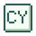

```text
                                                                      *    .
 ooooooooooooo oooo                   o8o                    .   *   /\   ~*~   .
 8'   888   `8 `888                   `"'                 ~*~       /  \      *
      888       888 .oo.    .oooo.   oooo   .oooo.o           .    /  * \  .--~*
      888       888P"Y88b  `P  )88b  `888  d88(  "8      *--~~.   /  .   \     .
      888       888   888   .oP"888   888  `"Y88b.            '  / *   .  \ ~*~
      888       888   888  d8(  888   888  o.  )88b       .     /__________\    *
     o888o     o888o o888o `Y888""8o o888o 8""888P'      ~*~  (______________) .
                                                            .    *  ~~*~~   *

 .-----------------------------------------------------------------------------.
 | (x) (-) (+)                     ~/sobre.txt                                 |
 |-----------------------------------------------------------------------------|
 |                                                                             |
 | QA Engineer no Instituto Conecthus, com cerca de 2 anos de experiência      |
 | em qualidade de software em projetos de Pesquisa e Desenvolvimento.         |
 | Certificada ISTQB CTFL.                                                     |
 |                                                                             |
 | Manaus, AM                                                                  |
 | -@Thaiss26                                                                  |
 |                                                                             |
 '-----------------------------------------------------------------------------'
```

<p></p>

<p>
  
</p>

<p></p>

<p>
  <a href="https://www.linkedin.com/in/tha%C3%ADssilva26"></a
  ><a href="https://github.com/Thaiss26"></a
  ><a href="https://instagram.com/thaiss15__"></a
  ><a href="mailto:contato.thaissilva@outlook.com"></a>
</p>

```text
 thaiss26@github ~ % exit
 logout
 Saving session...completed.

 [Process completed]▌
```
